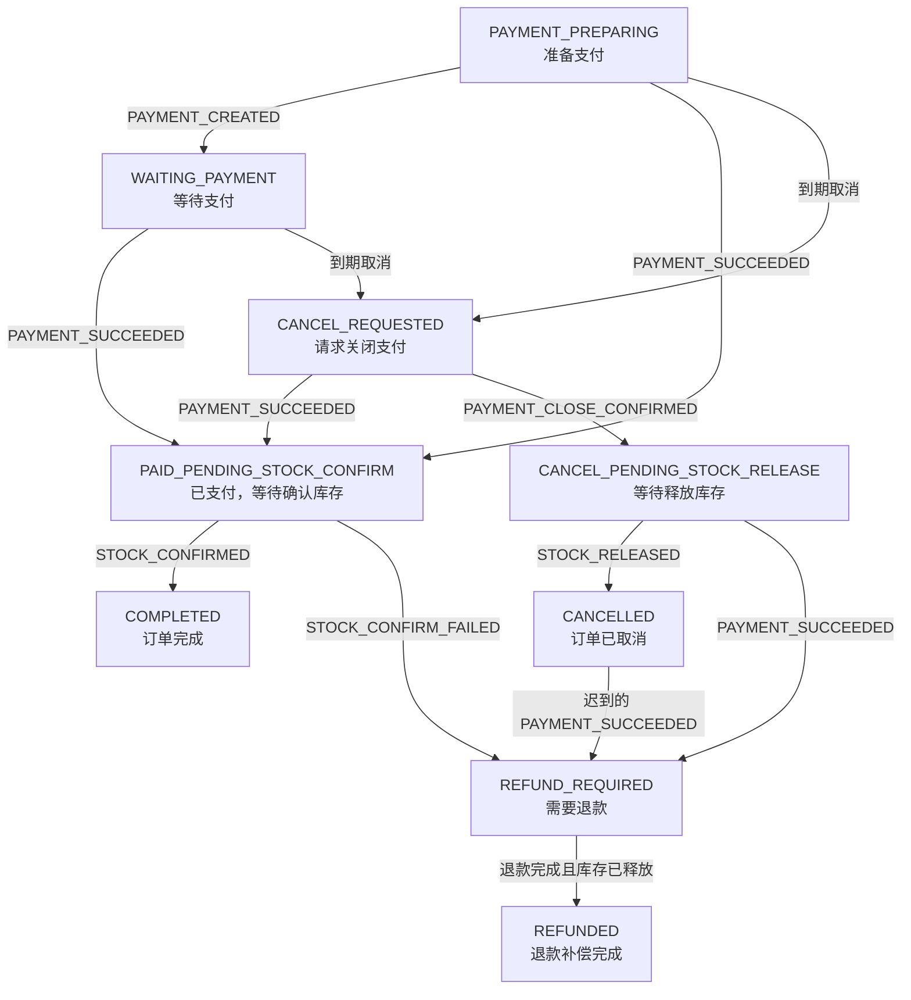

# 交易平台：Seata AT + Saga + RocketMQ

Java 21 / Spring Boot 3.5.14 / MyBatis-Plus 3.5.17 / Seata 2.6.0 / RocketMQ Spring 2.3.0 / RocketMQ 客户端 5.1.4。
生产使用 MySQL 8.4；H2 只用于本地事务与并发测试，不能模拟 Seata AT。

## 流程

1. 下单使用 `@GlobalTransactional`：创建订单及 Saga、同步库存预留，并通过官方 `SeataMQProducerFactory` 发送支付创建半消息。数据库 AT 分支和消息分支由同一个 Seata 全局事务协调。
2. 全局提交后支付命令才对消费者可见；全局回滚则消息与库存一起回滚。不再存在 AT 提交后另启 Saga 的衔接窗口，也不再扫描 AT_PENDING 激活订单。
3. 支付、库存和订单后续 Saga 步骤使用 `RocketMQTemplate.sendMessageInTransaction`。半消息成功后，`@RocketMQTransactionListener` 调用 Spring 本地事务，业务变更、Inbox 和 `message_transaction.COMMITTED` 一起提交，再返回 COMMIT。
4. 同一步骤的多条输出放在一个 `MessageBatch` 内，避免只发布退款、遗漏释放库存。规划与实际执行结果发生竞争时，回滚本次半消息并重新读取状态重试。
5. 渠道任务在数据库事务外调用网络，稳定支付号、退款号、主动查询及 Saga 恢复机制继续保留。订单仍等待库存确认完成；退款与释放库存均确认后才结束补偿。

所有持久化访问使用 MyBatis-Plus；本地事务使用 Spring 注解，AT 使用 Seata Starter 和注解，消息使用 RocketMQ Spring。业务代码没有手动 TransactionManager、TransactionTemplate 或 JDBC。

## 启动

新建开发环境：

```powershell
docker compose -f deploy/docker-compose.yml up -d
./deploy/Initialize-Messaging.ps1
mvn clean package
$env:INTERNAL_SERVICE_TOKEN = 'replace-with-a-random-shared-token'
java -jar stock-service/target/stock-service-1.0.0-exec.jar
# 在另外两个终端设置相同的 INTERNAL_SERVICE_TOKEN 后执行：
java -jar payment-service/target/payment-service-1.0.0-exec.jar
java -jar order-service/target/order-service-1.0.0-exec.jar
```

Compose 的 MySQL 初始化脚本从各服务的 `schema-mysql.sql` 创建数据库及 `undo_log`。已有数据库不会自动迁移；本次增加事务回查表的脚本见 `deploy/mysql/migrations/001-transaction-messages.sql`。先停止新请求并让旧 Outbox、旧 Topic 消息和旧 AT_PENDING 全部处理完成，再切换新版本。脚本不会删除旧 Outbox 数据。旧 H2 数据文件没有被迁移或修改。

默认端口：订单 8081、库存 8082、支付 8083、MySQL 3306、Seata 8091、NameServer 9876。示例账号仅用于本地开发。应用运行在宿主机，因此 Broker 与 Seata 的通告地址默认是 127.0.0.1；跨机器部署必须修改 `brokerIP1` 和 `SEATA_ADVERTISE_IP`。

`DB_URL`、`DB_USER`、`DB_PASSWORD`、`SEATA_SERVER`、`STOCK_BASE_URL`、`ROCKETMQ_NAMESRV` 可覆盖连接配置。订单、库存必须连接同一个 TC 事务组。多实例共享对应的 MySQL 数据库，不能各自连接独立 H2 文件。

## 支付渠道适配

当前默认启用 `MockPaymentChannelGateway`：创建支付后主动查询直接返回模拟成功，产生 `PAYMENT_SUCCEEDED`，无需手动操作。查询订单接口观察状态推进。模拟渠道不发生真实扣款，且回调验签始终返回 true，只能用于本地开发，不能用于生产。接入真实渠道时，提供 `PaymentChannelGateway` Bean 并启用 `payment-channel` Profile：

- 验证原始渠道通知的签名、商户身份和事件标识。
- create 按固定 paymentNo 幂等；退款按固定 refundNo 幂等。
- 查询结果区分 PAID、UNPAID、CLOSED、NOT_FOUND、UNKNOWN。
- 退款查询必须返回可校验的支付号、退款号、金额、币种和渠道退款流水。
- 网络超时必须有界（建议不超过 10 秒，低于 60 秒领取租约），超时不能被翻译为“未付款”。
- CLOSED 必须代表渠道已阻止该支付号继续扣款。创建结果未决时关闭任务等待创建被解析，不能提前释放库存。

当前没有指定支付宝、微信等渠道凭据，因此真实验签和渠道日账单下载需要由具体适配器实现。主动查询任务已覆盖漏回调后的状态恢复；它不能替代财务日账单对账。

## API

创建订单：`POST /api/orders`，请求头 `Idempotency-Key`。

```json
{"userId":10001,"skuId":1001,"quantity":2,"amount":299.00,"currency":"CNY"}
```

示例库存单价为 149.50 CNY。相同用户、相同幂等键但不同参数返回 409。

查询：`GET /api/orders/{orderNo}`。到期取消：`POST /api/orders/{orderNo}/cancel`。
支付通知：`POST /api/payments/channel-callback`，数据结构见 `PaymentController.ChannelCallback`，只有渠道验签通过才处理。

## 故障与重放

生产发布不再使用 Outbox、Relay 或扫描重发。`message_transaction` 保存 PREPARED、COMMITTED、ROLLED_BACK、事务批次摘要和审计载荷，由 Broker 回查时按需读取。没有待发送队列或扫描发送任务。

执行前先持久化 PREPARED，再发送半消息；本地事务锁定该记录，与业务同时写入 COMMITTED。回查遇到数据库不可用、记录暂缺或未到截止时间时返回 UNKNOWN。过期 PREPARED 只有拿到 NOWAIT 行锁后才可转为 ROLLED_BACK；正在执行的事务不会被回查误回滚，已被判定回滚的事务也不能迟到执行。

本地事务超时 15 秒，准备记录截止时间 120 秒。Broker 检查周期/次数必须覆盖该窗口，且不能在仍可能执行时丢弃半消息。配置示例见 broker.conf。事务记录至少保留至 Broker 所有回查及消息保留窗口结束，不能按业务终态立即删除。

事务 Topic 为 `ECOMMERCE_TRADING_TX`，类型为 TRANSACTION。Seata 使用 `*-seata-tx-producer`，RocketMQ Spring 使用 `*-local-tx-producer`，两套生产者和回查监听器分离。同一生产者组的实例必须连接同一业务数据库。

每个业务消费组最多重试 16 次，耗尽进入 RocketMQ DLQ。DLQ 审计监听器将原始消息保存到 `message_failure`，审计保存失败会继续重试。`replay_audit` 保留重放请求。

所有 `/internal/` 接口要求 `X-Service-Token`，由 `INTERNAL_SERVICE_TOKEN` 配置。运维入口应放在受控网络，并通过运维网关确认真实操作人：

- `POST /internal/messages/failures/{id}/replay`，对当前服务指定消费组的故障消息执行原事件重放。
- 请求体为 `{"operator":"操作人","reason":"处理原因"}`。保留原 eventId，已成功处理的消息不会被强制重复执行。业务修正应产生新的补偿命令，不能删除 Inbox。

应监控长期 PREPARED、回查 UNKNOWN/异常、DLQ/故障审计增长、UNKNOWN 渠道任务年龄和 Saga ATTENTION_REQUIRED。达到 Saga 重试阈值会标记待关注并继续有界调度；不会伪装成补偿完成。

## 验证

```powershell
mvn test
# 启动 Compose 中的 MySQL、Seata 和 RocketMQ 后，创建测试 Topic：
./deploy/Initialize-Messaging.ps1 -IncludeIntegrationTopic
# 运行真实 AT + MQ 验收：
mvn -Pat-it verify
```

常规测试覆盖支付/关单竞态、创建与关闭乱序、退款超时恢复、渠道流水唯一性、库存并发确认/释放、订单补偿闭环、Inbox 回滚、半消息失败、二次确认丢失回查、未决事务 fencing、并发重新规划和多事件批次原子性。

`at-it` 独立模块启动订单和库存的实际 HTTP 服务，验证 XID 传播、双分支提交，远端库存分支提交后发生价格错误时的全局回滚，以及半消息已发送后异常导致数据库与消息共同回滚。该测试依赖真实 MySQL、TC 与 Broker，不能用 H2 测试结果代替。进一步的 TC 宕机、Broker 掉电、跨进程租约暂停及主备切换演练见 `docs/production-checklist.md`。

`OrderFlow` 以订单状态为中心，接收支付和库存事件，再决定更新订单状态以及发送下一条命令。正常完成、超时取消、退款补偿是三条主要路径。



| 当前订单状态 | 输入事件或条件 | 订单服务处理 | 发往其他服务 |
|---|---|---|---|
| `PAYMENT_PREPARING` | `PAYMENT_CREATED` | 更新为 `WAITING_PAYMENT` | — |
| `PAYMENT_PREPARING`、`WAITING_PAYMENT` | 收到 `PAYMENT_SUCCEEDED` | 校验支付号、金额和币种；更新为 `PAID_PENDING_STOCK_CONFIRM` | 向库存服务发送 `STOCK_CONFIRM_REQUESTED` |
| `PAID_PENDING_STOCK_CONFIRM` | `STOCK_CONFIRMED` | 更新为 `COMPLETED`；Saga 标记 `SUCCEEDED` | — |
| `PAYMENT_PREPARING`、`WAITING_PAYMENT` | 支付到期，触发取消或恢复 | 更新为 `CANCEL_REQUESTED` | 向支付服务发送 `PAYMENT_CLOSE_REQUESTED` |
| `CANCEL_REQUESTED` | `PAYMENT_SUCCEEDED` | 支付先于关单确认成功，转为 `PAID_PENDING_STOCK_CONFIRM` | 向库存服务发送 `STOCK_CONFIRM_REQUESTED` |
| `CANCEL_REQUESTED` | `PAYMENT_CLOSE_CONFIRMED` | 更新为 `CANCEL_PENDING_STOCK_RELEASE` | 向库存服务发送 `STOCK_RELEASE_REQUESTED` |
| `CANCEL_PENDING_STOCK_RELEASE` | `STOCK_RELEASED` | 更新为 `CANCELLED`；Saga 标记 `COMPENSATED` | — |
| `PAID_PENDING_STOCK_CONFIRM` | `STOCK_CONFIRM_FAILED` | 更新为 `REFUND_REQUIRED`，标记库存已释放 | 向支付服务发送 `REFUND_REQUESTED` |
| `CANCEL_PENDING_STOCK_RELEASE`、`CANCELLED` | 迟到的 `PAYMENT_SUCCEEDED` | 更新为 `REFUND_REQUIRED` | 向支付服务发送 `REFUND_REQUESTED` |
| `REFUND_REQUIRED` | `REFUND_SUCCEEDED` 或 `STOCK_RELEASED` | 分别记录退款完成、库存释放；**两者都完成**后更新为 `REFUNDED`，Saga 标记 `COMPENSATED` | 未完成的步骤由恢复任务重试 |

主要代码在 [OrderFlow.applyConsume()](E:/code/seata-demo/order-service/src/main/java/com/acme/ecommerce/order/OrderFlow.java:159)。事件由订单服务消费者接收后进入这里；处理前通过 Inbox 去重，库存、支付和退款事件还会校验对应业务数据。

[OrderFlow.applyRecover()](E:/code/seata-demo/order-service/src/main/java/com/acme/ecommerce/order/OrderFlow.java:255) 负责恢复卡住的流程：根据当前订单状态重新发送支付创建、关单、库存确认、释放或退款命令。重试达到 100 次后，Saga 标记为 `ATTENTION_REQUIRED`，但仍保留后续恢复能力。


